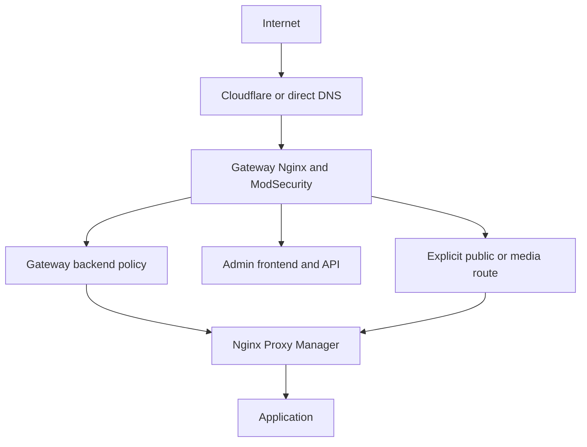

# Security Gateway — Operator and Maintenance Guide

Updated November 26, 2026. For the self-hosted Unraid deployment and its maintainers.

This guide describes the installed application source inspected during recovery. It is an operating reference, not a claim that every feature on the roadmap is complete. The installed checkout contains changes that are not all present on GitHub's default branch. Match a deployment's source revision, image tags and configuration before relying on a feature described here. Historical deployment notes record checks at their own dates, not permanent guarantees.

No credentials, private keys, live home IP addresses or exported production configuration belong in this document.

## Contents

1. [Purpose and architecture](#purpose-and-architecture)
2. [Administrator screens](#administrator-screens)
3. [Sign-in, approvals and device trust](#sign-in-approvals-and-device-trust)
4. [Networks and real client addresses](#networks-and-real-client-addresses)
5. [Registering an application](#registering-an-application)
6. [Notifications](#notifications)
7. [Deployment and development](#deployment-and-development)
8. [Persistence and backups](#persistence-and-backups)
9. [Routine operations](#routine-operations)
10. [Troubleshooting](#troubleshooting)
11. [Developer reference](#developer-reference)
12. [Verification and known limitations](#verification-and-known-limitations)

## Purpose and architecture

Security Gateway controls whether a request may reach an application behind Nginx Proxy Manager (NPM). It combines user authentication, browser/device identity, time-limited approvals, network policy, blocking, security events and notifications. NPM continues to route allowed requests to the final application.



The diagram shows logical enforcement; the backend can proxy protected application traffic. Explicit public/media routing can bypass that backend path for compatibility and large uploads. Such a bypass must be intentional and relies on the application for any required authentication.

| Service | Responsibility |
|---|---|
| `gateway-nginx` | Public ports 80/443, TLS, trusted edge headers, routing and ModSecurity integration |
| `backend` | ASP.NET Core API, sign-in, access decisions, approvals, policy and background tasks |
| `frontend` | React/TypeScript administrator interface |
| `postgres` | Durable application records, identities, policies, audit and notification state |
| `redis` | Cache and runtime coordination used by access/security services |
| `nginx-proxy-manager` | Upstream proxy hosts and certificate management where configured |
| `waf-log-forwarder` | Reads audit logs and forwards WAF events to the application |

The backend follows Domain → Application → Infrastructure → API boundaries, with EF Core/PostgreSQL. The frontend uses React, TypeScript and Vite. ModSecurity and the OWASP Core Rule Set supply WAF inspection; their enforcement depends on the selected mode. Detection-only mode records events without blocking them.

Protected traffic must fail closed. Keep a trusted LAN administration path for Unraid. Do not expose backend, database, Redis or NPM administration directly to the Internet. An explicit public route is an exception to gateway approval, not proof that all applications are protected.

## Administrator screens

| Screen | Use |
|---|---|
| Dashboard | Overview of activity and security information |
| Approvals | Review requests awaiting sign-in or administrator approval |
| Apps | Register hosts, edit access policies and configure Routing & HTTPS |
| Networks | Manual trusted networks and separate automatic home-network access |
| Devices | Inspect browser/device records and trust or block them |
| Alerts / Notifications | Delivery channels, event subscriptions and delivery history |
| Events | Security detections and related activity |
| Block | Manage explicit access blocks |
| Audit | Review administrative and authentication actions |
| Map | Geographic overview of known event locations |
| IP Explorer | Investigate an address and its available enrichment |
| Health | Diagnose service connectivity and health |

A healthy page shell does not prove its authenticated API calls work. Check the data load and errors on the screen.

## Sign-in, approvals and device trust

### Request lifecycle

1. A visitor opens a registered protected application.
2. Gateway evaluates application policy, blocks, identity and applicable trust.
3. If authentication is needed, the visitor sees the sign-in stage.
4. After sign-in, a request that still lacks access appears under **Needs approval**.
5. An administrator approves or denies it, choosing a scope and optional reason.
6. A matching grant permits the signed-in user to reach that application until the grant expires or is revoked, subject to other policy checks.

**Authentication required** contains requests without an authenticated user. **Needs approval** contains authenticated requests ready for review. These stages are also separate notification subscriptions. They are not interchangeable approvals.

### Approval scope reference

The installed `AccessRequestService` defines the following fixed lifetimes, starting at approval time:

| UI scope | Lifetime | Required matching identity beyond application and user |
|---|---|---|
| Once | 1 hour | IP, browser fingerprint and authenticated session; currently behaves as Session |
| Session | 1 hour | IP, browser fingerprint and authenticated session |
| Device | 30 days | Same browser fingerprint; IP/session may change |
| IP + Device | 7 days | Same IP and browser fingerprint; session may change |
| IP | 1 day | Same IP; another browser session of the same user can match |
| Permanent | No scheduled expiration | Same browser fingerprint; IP/session may change |

**Once is not a single HTTP request.** Its current mapping is the Session scope. Do not use it expecting one-request consumption.

Approval records belong to an application and user. An IP approval does not authorize every person at that IP. Expiration is evaluated during access checks; refresh does not reset its fixed expiry. Other active grants or bypass policies may still permit access after one grant expires.

Authentication and approval have different clocks. The inspected protected-app session implementation uses up to seven days for sign-in; browser identification cookies can last up to 365 days with renewal after 90 days. These do not extend a one-hour Session approval. Pending requests have a 30-minute review window. Confirm these settings again after authentication changes.

Trusting a device in **Devices** is separate from approving one request with the **Device** dropdown scope. A trusted-device record can participate in access decisions beyond that individual approval; its effect still depends on application policy and blocking state. Inspect the device record and applicable grants rather than assuming both controls create the same record or expiry.

A VM/browser can appear new after a restart if its profile, cookies or browser identity are recreated. Private browsing, cookie clearing and switching browsers can also lose matching identity. Permanent approval does not survive loss of the identity it matches. Do not fix this by approving unrelated IPs or disabling blocks.

### Revocation and denial

Use device blocking/untrusting, access-request decisions and the relevant policy controls deliberately. Logout ends authentication; it does not necessarily delete every independent approval record. Account/session revocation and blocks can override access. Confirm the result from a fresh request without relying on an already-rendered page.

## Networks and real client addresses

### Manual trusted networks

A manual network is an explicit CIDR entry. Prefer the narrowest intended scope, such as an exact public IPv4 `/32`, rather than a broad ISP range. In the inspected controller, administrator approval operations require the Administrator role and, once any trusted networks are configured, a matching trusted admin network. That additional restriction can produce **403** while the user remains signed in.

### Automatic home access

This is a separate feature from manual trusted networks and their administrator restriction:

- Disabled until enabled by an administrator.
- Uses direct IPv4 HTTPS checks against `api.ipify.org` and `v4.ident.me`; both must agree on a valid public IPv4.
- Checks at startup and about every ten minutes.
- Becomes inactive if no successful confirmation exists within thirty minutes.
- Replaces the previous automatic address when the public address changes.
- Grants eligible **signed-in** home clients access subject to application policy and blocks.
- Does not create permanent device trust and does not infer an IPv6 prefix.

Automatic home state persists in the backend keys volume as `home-network.json`. A changed public IPv4 does not automatically rewrite every manual trusted network or external DNS record. Check those separately.

### Trusted proxy chain

Only explicitly trusted proxies may supply client-IP headers. The backend `Gateway__TrustedProxies` setting identifies the gateway proxy; the Nginx edge must accept Cloudflare's real-IP headers only from validated Cloudflare ranges. Do not trust every Docker container, arbitrary `X-Forwarded-For`, or a whole bridge as a shortcut.

When correct, an audit login shows the visitor's address rather than a private Docker bridge address. Proxy identity, network trust and application access policy are distinct settings.

## Registering an application

1. Confirm the app works on its real container/network address and port.
2. Configure its NPM proxy host and test upstream connectivity.
3. Point the public hostname at the intended edge. A Cloudflare-proxied record and a direct-DNS record have different TLS requirements.
4. In **Apps**, add the application name, exact hostname and upstream route. Using the existing NPM service as upstream is appropriate when NPM owns the final host routing.
5. Set the app's access policy, including whether authentication and approval are required.
6. Open **Routing & HTTPS**, choose the appropriate preset, preview the resulting settings, then apply.
7. Test both an anonymous request and an authorized request, along with application features such as WebSockets or uploads if needed.

### Routing presets

| Preset | Intended use |
|---|---|
| Standard protected | Gateway policy checks for ordinary protected applications |
| Direct public | Intentionally public websites or services with their own access controls |
| Media | Media services requiring compatible uploads, timeouts and WebSockets |
| Custom | Supported individual controls for a deliberate exception |

TLS/certificate choice is independent of access policy. The editor controls supported upload limits, timeout, WebSockets, WAF/body inspection and certificate selection. It does not accept arbitrary Nginx snippets.

A Cloudflare Origin certificate is for an appropriately proxied origin connection; it is not a normal browser-trusted certificate for a direct public hostname. Direct DNS needs a matching public certificate. Selecting a certificate does not itself configure NPM issuance, renewal or force-SSL settings.

A host routing worker validates settings and certificate coverage, renders routes, tests Nginx and reloads after successful validation. It operates outside the backend rather than granting the backend a Docker socket. Desired settings and certificates must persist. Generated configurations may contain an internal credential and must stay out of Git.

For large media uploads, verify the route actually bypasses backend proxy limitations as intended. An unlimited Nginx body setting does not remove a CDN's own upload limit. Preserve application-specific authentication when bypassing Gateway approvals.

## Notifications

The guided setup supports **ntfy, Email, Telegram and Discord**. A WebPush provider also exists in source; provider code alone does not establish that a complete user-facing setup is available. Check the capabilities response and UI for the deployed version.

| Method | Information to prepare privately |
|---|---|
| ntfy | Server URL, topic and any required authentication |
| Email | SMTP server/port, transport requirements, sender, recipient and app password where required |
| Telegram | Bot credential and destination chat identifier |
| Discord | Destination webhook |

Set up ntfy as the primary method if desired, then configure another method as backup. Set delivery mode and backup order explicitly; multiple configured methods are not automatically equivalent to fallback. Backup delivery still obeys each method's event filters.

Choose **Needs approval** and **Authentication required** independently. These checkboxes subscribe to future events; their labels are not live pending-request counters. High and critical alerts are separate selections. Older channels inherit the legacy access-request selection when stage-specific values are missing.

Use the explicit test action only when you intend to send a real message. Review delivery history and errors. Do not publish channel exports, SMTP passwords, bot credentials, webhook URLs or private ntfy topics. A missing provider credential cannot be repaired by changing an access policy.

## Deployment and development

### Existing Unraid deployment

The authoritative Compose project is typically:

```text
/boot/config/plugins/compose.manager/projects/Security-Gateway/
  docker-compose.yml
  docker-compose.override.yml
  .env
  project-name
  autostart
```

Use the **base and override together**. Production overrides can select locally built image tags that cannot be pulled from a registry. Do not replace the project with the repository's development Compose file.

For an existing installation, review settings privately and inspect status:

```bash
SG_PROJECT_DIR=/boot/config/plugins/compose.manager/projects/Security-Gateway
cd "$SG_PROJECT_DIR"
docker compose -p security-gateway -f docker-compose.yml -f docker-compose.override.yml config --quiet
docker compose -p security-gateway -f docker-compose.yml -f docker-compose.override.yml ps
```

After verified backups and a deliberate image/configuration change, apply through Compose Manager or the same complete file pair:

```bash
docker compose -p security-gateway -f docker-compose.yml -f docker-compose.override.yml up -d
```

A plain `config` without `--quiet` can print resolved secrets. Keep it private. `down -v` is destructive to named volumes and is not a routine restart command. Check restart policies and Compose Manager autostart separately; one setting does not imply the other.

The host routing worker startup script in the inspected installation is `/boot/config/plugins/security-gateway/start-routing-worker.sh`. It must start after Docker and keep its private runtime inputs protected. Verify it is running after a host restart.

### Fresh development checkout

```bash
git clone https://github.com/kamil0103/Security-Gate.git
cd Security-Gate
cp .env.example .env
```

Set new development secrets before startup. Inspect the checked-out Compose files for their service ports and dependencies, then start that development project. Never reuse production credentials or mount production databases into a development stack.

The original quick-start examples are historical. In the installed API, the login JSON wraps credentials inside `user`:

```json
{
  "user": {
    "usernameOrEmail": "YOUR_USERNAME",
    "password": "YOUR_PASSWORD"
  }
}
```

Use placeholders only in saved examples. The login endpoint is `POST /api/auth/login`; the response includes an access token and refresh-token handling uses a cookie. Do not print tokens, persist them in shell history, or paste login responses into an issue.

## Persistence and backups

Keep active PostgreSQL data, Redis persistence where configured, NPM configuration/certificates and Gateway keys on their intended persistent mounts. The backend keys mount includes browser/device identity and desired routing/home settings; recreating it can disrupt identity or routing.

| Item | Backup consideration |
|---|---|
| PostgreSQL | Prefer a consistent logical backup; verify archive readability and perform isolated restore drills |
| Compose files and `.env` | Preserve as private deployment material with restricted permissions |
| Backend keys/state | Preserve permissions; these are not disposable image caches |
| NPM data and certificates | Preserve ownership, ACLs and private-key read permissions |
| Nginx persistent template and routing inputs | Back up privately; generated files can contain credentials |
| Application source and local-only image references | Preserve source revision and enough build inputs to reconstruct local images |
| Logs | Apply explicit retention and protect their sensitive request metadata |

A Docker image backup is not a backup of bind-mounted appdata. Copying a corrupt image preserves corruption. A live recursive copy of PostgreSQL files is not a substitute for a consistent database backup. Do not overwrite a running database with a filesystem copy.

During the November recovery, inactive Gateway backups moved to an array destination through a compatibility symlink. WAF audit logs moved to an array bind mount outside the Docker image. Docker stdout/stderr logs were capped at 10 MiB per file with three files per container. **That Docker setting does not rotate WAF audit files**; independent WAF retention remains a maintenance item.

Restrict backup parents because they can contain keys and passwords. Verify ACLs as well as byte hashes when crossing filesystems. An array copy on the same server is useful recovery material, but is not an offsite backup.

## Routine operations

- Check both Apps-pool free space and the separate Docker filesystem's free space.
- Inspect database/cache health, restarting containers and authenticated page data loads.
- Confirm real client-IP attribution and matching trusted networks after network changes.
- Confirm public DNS after an ISP address change, including domains outside Cloudflare.
- Track TLS expiry/renewal and routing-worker operation.
- Review notification delivery failures and security/audit events.
- Keep application images, source revisions and private deployment backups associated.
- Measure representative load before changing CPU or memory limits.

The recovery priority policy assigns Gateway services CPUs 0–1 with CPU shares 2048. Existing memory/quota limits remain deployment settings. CPU eligibility and relative shares are not reserved CPU capacity, and the Linux VM also uses those cores in the inspected host.

## Troubleshooting

### Approvals shows 403 while the UI says Administrator

1. Verify the failing endpoint is `/api/access-requests/pending` or `/recent`, rather than assuming the frontend shell proves API authorization.
2. Confirm the account role and that its sign-in is valid.
3. Inspect the trusted admin network and the **resolved client IP** in a recent login audit record.
4. If the audit shows a Docker address, repair the proxy/network attribution. Do not add the Docker bridge as a trusted home network.
5. After repair, test with an authenticated admin request and refresh the Approvals page.

In November recovery, obsolete NAT `POSTROUTING` MASQUERADE rules referenced deleted Docker bridges. They rewrote proxy connections to the bridge gateway address, so backend trusted-proxy resolution could not recover the visitor IP. Removing only verified obsolete rules, then reloading Gateway Nginx, restored pending/recent API responses to HTTP 200 and real client-IP audit entries. The trusted-network authorization check remained enabled.

### Containers resolve each other but database TCP times out

Check host-to-database connectivity separately from container-to-container connectivity. Inspect current Docker networks, bridge interfaces and these read-only firewall views from Unraid Terminal:

```bash
iptables -t raw -S PREROUTING
iptables -t nat -S POSTROUTING
iptables -S DOCKER-USER
iptables -S DOCKER-FORWARD
iptables -S DOCKER
```

A raw DROP rule that references a deleted bridge can block packets to a reused container address. A stale NAT rule can also change the source address even after connectivity returns. Compare every suspect bridge against current interfaces and Docker networks before any deletion. Remove only exact obsolete rules after recording them privately. Do not flush firewall tables, remove working Docker rules or disturb libvirt/WireGuard rules. Existing connections may need renewal after a NAT repair.

### Bad Gateway / 502

Check the target container, actual published port, network reachability and NPM proxy-host target. A container's internal port and its host-published port are not interchangeable. If an app was moved to another host port, update the relevant NPM route. Validate routing preview, test Nginx and check the worker's apply result. Avoid replacing unrelated security settings to repair one upstream.

### Location or ISP/ASN is Unknown

Verify the recorded IP is a real public visitor address. Private bridge addresses have no useful public location. Check local GeoIP data files, mount permissions and enrichment availability. Missing enrichment is not proof of an attack or a healthy lookup service. Do not change approval rules merely to hide Unknown values.

### WAF forwarder restarts with Permission denied

Compare the proxy's log ownership, audit-directory permissions and forwarder UID/GID. In the recovered installation the proxy owns logs as 101:101; running the forwarder as 101:101 fixed access to the read-only mount. Preserve narrow permissions instead of making audit logs world-writable. Rotation design must account for whether the forwarder follows a renamed or truncated file.

### A trusted browser requests approval again

Identify the exact expired or mismatched grant. Check scope, user, application, IP, session and browser fingerprint. Verify the browser profile persists, especially in a VM. Check device trust separately from the request's approval scope. Check home auto-access freshness if applicable. Never assume a long-lived cookie means a one-hour approval lasts equally long.

### Direct-DNS site fails but local HTTPS works

Compare its DNS result with the server's current public IPv4. Check router forwarding, hairpin/NAT behavior and certificate coverage. A successful Cloudflare-proxied hostname does not prove a separate direct-DNS hostname points to the right origin. Verify externally after a DNS change.

## Developer reference

Important source locations:

```text
backend/src/SecurityGateway.Api/Controllers/
backend/src/SecurityGateway.Api/AccessControl/HomeNetworkService.cs
backend/src/SecurityGateway.Infrastructure/AccessControl/Services/AccessRequestService.cs
backend/src/SecurityGateway.Infrastructure/AccessControl/Services/AccessControlService.cs
backend/src/SecurityGateway.Infrastructure/Gateway/ForwardedHeadersClientIpResolver.cs
backend/src/SecurityGateway.Infrastructure/Notifications/
backend/tests/SecurityGateway.Tests/
frontend/src/lib/api.ts
frontend/src/lib/auth.ts
frontend/src/modules/
docs/
```

| API area | Purpose |
|---|---|
| `/api/auth` | Authentication/session operations |
| `/api/access-requests` | Request status and administrator review |
| `/api/applications` | Registered applications; policies under `/{applicationId}/policy` |
| `/api/access-control` | Network/access administration |
| `/api/devices` | Browser/device management |
| `/api/notifications` | Channels, delivery configuration and history |
| `/api/audit` | Administrative audit history |
| `/api/map`, `/api/ip` | Map and IP enrichment views |
| `/api/health` | Service health |

This is an orientation table, not a promise that every subroute is anonymous or accepts writes. Read the relevant controller, DTO and authorization attributes before using an endpoint. Never bypass role/network checks to make a diagnostic succeed.

Run the repository's relevant tests for code changes:

```bash
cd backend
dotnet test SecurityGateway.sln
```

In a separate frontend shell:

```bash
cd frontend
npm ci
npm test
npm run build
```

Some backend suites require Docker/Testcontainers and an isolated database. Use suitable development resources; do not point tests at production state. Documentation-only edits do not require restarting the application or rerunning all service tests. Validate document links, paths, examples and absence of secrets.

Follow [CONTRIBUTING.md](CONTRIBUTING.md): use a focused branch, conventional commits and a pull request. Do not publish `.env`, keys, database dumps, NPM exports, resolved production Compose output, generated authenticated Nginx configuration or private recovery logs.

## Verification and known limitations

This guide combines inspected code, existing feature validation notes and direct November recovery checks. Those recovery checks established container startup, API connectivity, real-IP correction and selected persisted-data access. They did not establish complete browser workflows, peak-load stability, real notification delivery, every upstream app's behavior or a full cold-start/restore drill.

Keep these limitations visible:

- Once currently aliases Session rather than consuming a single request.
- Automatic home access is IPv4-only and distinct from manual admin-network trust.
- WAF mode determines whether detections block or only log.
- Public/media bypasses are deliberate exceptions to Gateway approvals.
- WAF audit retention is separate from Docker log rotation.
- Device identity depends on retained browser credentials/profile state.
- Installed source and GitHub main are not assumed to be identical.

For historical evidence, see the approval-scope, home-network, routing and notification notes in this checkout's `docs` directory when present. Preserve their dates and distinguish past test results from fresh verification.
